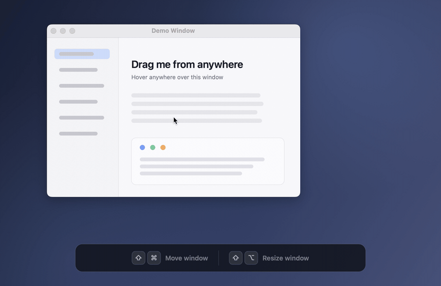

# OmniDrag

A lightweight macOS menu bar utility that lets you **move** and **resize** any window using keyboard shortcuts + mouse, without needing to grab the title bar or window edges.

Inspired by Linux window managers where `Alt+Drag` moves/resizes windows from anywhere.

## Usage



| Action | Shortcut |
|--------|----------|
| **Move window** | `Shift (⇧)` + `Command (⌘)` + Mouse Move |
| **Resize window** | `Shift (⇧)` + `Option (⌥)` + Mouse Move |

1. Hover over any window
2. Hold the shortcut keys
3. Move the mouse to drag or resize

The app runs as a menu bar icon — click it to see shortcuts or quit.

## Requirements

- macOS 13.0+
- Apple Silicon (arm64)
- **Accessibility permission** — the app will prompt you to grant it on first launch

## Install

### Download

Grab the latest release from [Releases](https://github.com/hotheat/omni-drag/releases):

- **OmniDrag-arm64.pkg** — double-click to install to `/Applications`
- **OmniDrag-arm64.app.zip** — unzip and drag to `/Applications`

### Build from source

```bash
./scripts/build.sh
```

The built app will be at `dist/OmniDrag.app`.

To also generate the `.pkg` installer:

```bash
./scripts/package.sh
```

To build a specific architecture explicitly:

```bash
TARGET_ARCH=arm64 APP_BUNDLE_NAME=OmniDrag ./scripts/package.sh
TARGET_ARCH=x86_64 APP_BUNDLE_NAME=OmniDrag-x86_64 ./scripts/package.sh
```

## Release

Tag pushes matching `v*` trigger GitHub Actions to build and upload:

- `OmniDrag-arm64.app.zip`
- `OmniDrag-arm64.pkg`
- `OmniDrag-x86_64.app.zip`
- `OmniDrag-x86_64.pkg`

You can also run the `Release` workflow manually for an existing tag via `workflow_dispatch`.

Pushes to `main` refresh the rolling build assets at these stable URLs:

- [OmniDrag-arm64.pkg](https://github.com/hotheat/omni-drag/releases/download/latest/OmniDrag-arm64.pkg)
- [OmniDrag-arm64.app.zip](https://github.com/hotheat/omni-drag/releases/download/latest/OmniDrag-arm64.app.zip)

The rolling release notes include the commit SHA and build date.
[releases/latest](https://github.com/hotheat/omni-drag/releases/latest) continues to point to the newest tagged version.

## How It Works

OmniDrag uses the macOS Accessibility API (`AXUIElement`) to detect the window under the cursor and programmatically set its position or size. It monitors global keyboard modifier flags and mouse movement events to provide a seamless drag/resize experience.

Window matching uses the owner process and geometry from CoreGraphics, then prefers standard AX windows and dialogs under the pointer over auxiliary overlays.
This handles applications such as Feishu that expose a watermark window with the same bounds as the main window.
Unknown AX window types remain supported when no standard window or dialog contains the pointer.

### Testing

```bash
mkdir -p build
swiftc Sources/WindowSelection.swift Tests/WindowSelectionTests.swift -o build/window-selection-tests && ./build/window-selection-tests
```

These checks cover candidate selection; live Accessibility permission and move/resize behavior must also be verified in the installed app.

## Project Structure

```
Sources/
├── main.swift            # App entry point
├── AppDelegate.swift     # Core logic: event handling, window tracking, move/resize
├── WindowSelection.swift # Rank standard windows/dialogs ahead of auxiliary overlays
└── DragLogger.swift      # File-based logging (~/.local/share/omnidrag/log/)
Resources/
├── Info.plist            # App metadata
└── Assets/               # Source artwork used to generate app/menu bar icons
scripts/
├── build.sh              # Build script (swiftc)
└── package.sh            # Package script (pkgbuild)
```

## Logs

Logs are written to `~/.local/share/omnidrag/log/` with daily rotation (only the current day's log is kept).

## License

MIT
